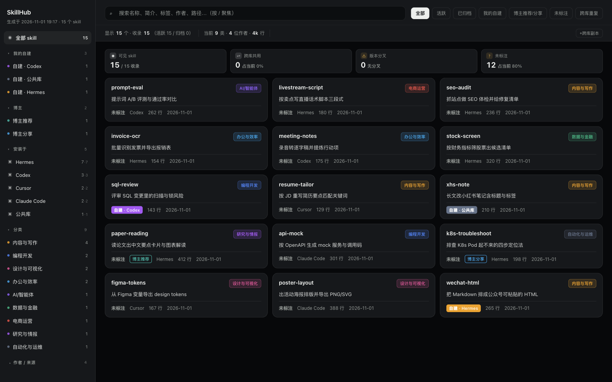

# SkillHub · 本机 Skill 总管家

把散落在 Hermes / Codex / Claude Code / Cursor / DeepSeek Harness 等一堆 AI 工具里的 skill 扫成**一张表**：自动分类、一句话功能备注、作者溯源，并把重复安装的第三方 skill 收成**一份实体 + 软链**。

> Read-only by default: 分类结果只写进 `output/`，**绝不修改任何 `SKILL.md`**。

<sub>**English** — SkillHub indexes the `SKILL.md` folders scattered across your AI coding agents (Claude Code, Codex, Cursor, Hermes, DeepSeek Harness…), classifies them, writes one-line notes, and deduplicates identical copies into a single `~/.agent-skills` store with symlinks. Local-only dashboard, zero dependencies, Python 3.9+.</sub>



<sub>↑ 截图用的是 demo 数据（`docs/dashboard.png`），不是任何人的真实 skill 库。</sub>

```bash
git clone https://github.com/hqaya316/skillhub.git && cd skillhub
cp config.example.json config.json      # 删掉你没装的软件那几行
python3 skillhub.py --no-llm            # 纯离线，秒出仪表盘
python3 serve.py                        # 本地面板 http://127.0.0.1:8778/
```

零第三方依赖，只要 Python 3.9+（标准库起服务、标准库调模型）。

### 想当软件用：双击一个 App

不习惯敲命令的话，克隆之后跑一条，就得到一个能拖进程序坞的应用：

```bash
bash scripts/build-app.sh        # 产物 dist/SkillHub.app
```

双击它会自己扫一遍、起面板、开浏览器，全程不弹终端；第一次跑完再双击就是秒开（已在跑就直接开面板，不会起第二个进程）。面板仍然是本机网页，只是启动方式变成了双击图标。

要开机常驻、崩了自动拉起，再叠一层 LaunchAgent：

```bash
bash scripts/install-launchagent.sh    # 卸载加 --uninstall
```

---

## 它解决什么

装了 5 个 AI 工具之后，skill 会散成三份麻烦：

1. **看不见** —— 同一个 skill 在 `~/.claude/skills`、`~/.codex/skills`、`~/.agent-skills` 各一份，谁在用哪份说不清。
2. **说不清是干什么的** —— 几百个目录，`SKILL.md` 里全是英文字段，想找一个「能把 Markdown 转公众号」的得挨个点开。
3. **重复占空间、升级要改多处** —— 同一个第三方 skill 三份实体，改一份另外两份还是旧的。

SkillHub 对应做三件事：**扫成一张表 / 自动分类+备注 / 归集成公共库**。

## 它认哪些库

`config.json` 里的 `roots` 决定扫哪里，删一行就是少扫一个库，不用改代码。开箱默认覆盖：

| 软件 | 默认路径 |
|---|---|
| Hermes | `~/.hermes/skills`、`~/.hermes/profiles/*/skills` |
| Codex | `~/.codex/skills`、`~/.codex/vendor_imports/skills` |
| Claude Code | `~/.claude/skills`（多为软链） |
| Cursor | `~/.cursor/skills-cursor` |
| DeepSeek Harness | `~/.dsh/profiles/*/skills` |
| cc-switch | `~/.cc-switch/skills` |
| 公共库 | `~/.agent-skills`（归集后的唯一实体） |
| 其它 | `~/.agents/skills`、`~/.skills-manager/skills`、`~/.gemini/...`、`~/.accio/accounts/*/skills` |

路径支持 `~` 和 `*`。想管自己的目录，加一行就行：

```json
{"path": "~/Documents/我的skills", "agent": "自定义", "label": "自建库"}
```

## 面板

`python3 serve.py` 起一个只监听 `127.0.0.1` 的小服务，页面里能做四件真事：

| 动作 | 行为 |
|---|---|
| 复制路径 | 复制 skill 目录路径 |
| 在 Finder 中显示 | 真的调 `open -R`（Linux 走 `xdg-open`） |
| **归档到公共库** | 实体移进 `~/.agent-skills`，各 agent 目录里那份换成软链；同名多版本取最新那份，旧的进废纸篓 |
| 移到废纸篓 | 走系统回收站，**可还原**；删公共库实体会先摘掉所有指向它的软链 |

界面是单文件 HTML（`template.html` 渲染出 `output/index.html`），也可以直接双击 `output/index.html` 静态看，只是文件操作按钮会置灰。

## 分类和作者怎么判

三层信号按权重打分，低置信的才交给模型复核：

1. **目录结构**（`creative/` → 设计，`ecommerce/` → 电商）—— 你自己分过的类最可信
2. **frontmatter tags + 简介中英关键词**
3. **LLM 复核**（可选）：批量读简介，输出分类 + 25 字内功能备注 + 识别的作者

规则高置信且与模型冲突时保留规则，并把分歧记在详情里（`category_llm` / `conflict`）。作者识别顺序：frontmatter `author` → 正文里的 GitHub 链接 → 所属技能包的作者 → 「未标注」，详情页能看到判定依据。

开 AI 备注（可选，任何 OpenAI 兼容接口）：

```bash
export SKILLHUB_LLM_KEY=sk-xxx
export SKILLHUB_LLM_BASE_URL=https://api.deepseek.com   # 默认就是它
export SKILLHUB_LLM_MODEL=deepseek-chat
python3 skillhub.py --open
```

不设密钥就是纯离线规则版，功能不缺，只是备注没那么准。

## 公共库：一份实体 + 软链

同一个第三方 skill 装在三个工具里，最容易踩坑的是「改了 A，B 还是旧的」。归集逻辑：

- 只归集**内容完全一致**的副本；已经分叉的版本单独列进 `pool-plan.md` 等你人工定
- 技能包（一个 skill 目录里套 75 个子技能那种）整包归集，不拆散
- 先出**方案 + 迁移脚本 + 回滚脚本**，执行必须再加 `--yes`

```bash
python3 skillhub.py --plan-pool              # 只看方案，不动文件
python3 skillhub.py --apply-pool             # 打印将执行的命令
python3 skillhub.py --apply-pool --yes       # 真执行（回滚脚本在 output/pool-rollback.sh）
python3 skillhub.py --add-to-pool vibe-trading --yes
python3 skillhub.py --link-to ~/.dsh/profiles/web/skills
```

## 安全模型

会动文件，所以边界写死：

1. **只读优先**：扫描阶段从不改 `SKILL.md`；所有产出落在 `output/`
2. **只监听 127.0.0.1**，每次启动生成一次性 token（`~/.skill-hub-token`，权限 0600），写操作必须带 `X-Hub-Token`
3. **Host 白名单**：只认 `127.0.0.1` / `localhost` / `[::1]`，挡掉 DNS rebinding 借浏览器读走 token
4. **Origin 白名单**：跨站请求一律 403，网页无法代你点按钮
5. **路径白名单**：删除 / 归档 / 软链只允许作用于 `config.json` 里配置的目录（`realpath` 前缀校验，兄弟目录 `skills-evil` 也进不来）
6. **删除可还原**：走系统回收站，不是 `rm -rf`
7. **密钥不落仓库**：只从环境变量读

这些都是 `tests/` 里逐条断言的，不是口头承诺。

## 开发与自检

```bash
python3 -m unittest discover -s tests -v   # 22 条单元测试
bash tests/smoke.sh                        # 端到端 13 项：隔离 HOME 造假 skill → 扫描 → 起服务 → 验权限
```

冒烟脚本不联网、不碰你真实的 skill 目录，跑完自己清理临时目录。

## 平台支持

| 平台 | 状态 |
|---|---|
| macOS | 完整：Finder 显示、废纸篓、LaunchAgent 常驻（`bash scripts/install-launchagent.sh`） |
| Linux | 可用：`xdg-open` 打开，废纸篓回落 `~/.Trash`；未长期实测 |
| Windows | 未适配（`osascript` / 软链语义不同），欢迎 PR |

## 已知限制

- macOS 想扫 `~/Documents` 下的库，要给 `/usr/bin/python3` 开「完全磁盘访问权限」（系统设置 → 隐私与安全性）；没开的话那几个库会显示读不到，程序会沿用上次索引而不是清空
- 纯离线扫 780 条实测约 1 秒；开 AI 备注要走模型批量请求（几十秒量级），之后内容没变的 skill 复用上次备注，不再请求模型
- 面板是单页 HTML，几万条会卡（正常个人用量在几百到几千条）

## 目录结构

```
skillhub.py            主程序：扫描 / 分类 / LLM 备注 / 生成仪表盘
taxonomy.py            分类体系、关键词规则、作者识别（要调分类改这里）
pool.py                公共库归集器：方案、迁移脚本、回滚、软链挂载
serve.py               本地面板服务 + 文件操作 API
template.html          仪表盘模板
config.example.json    扫哪些目录、公共库路径、LLM 参数
origins.example.json   自建/博主标注（运行时自动生成 origins.json）
scripts/build-app.sh         打成 dist/SkillHub.app（双击即用）
scripts/app-launcher.sh      .app 里的启动器（构建时注入代码目录与端口）
scripts/install-launchagent.sh  开机常驻
scripts/open-panel.command   双击开面板（不装常驻也能用）
tests/                 单元测试 + 端到端冒烟
docs/dashboard.png     README 用的仪表盘截图（demo 数据）
output/                生成物：skills.json / data.json / index.html（已 gitignore）
dist/                  打包产物 SkillHub.app（已 gitignore）
```

## Roadmap

- [x] GitHub Actions：单元测试 + 冒烟（ubuntu / macOS × 3.9 / 3.12）
- [x] 双击即用的 macOS `.app`（构建式，不含运行时）
- [ ] 独立分发包：`.app` 内自带 Python + 代码（PyInstaller），别人 clone 都不用
- [x] README 首屏截图（demo 数据）
- [ ] English README 全文 / 30 秒 demo（GIF）
- [ ] `pipx install` 打包（当前数据文件按脚本目录解析，还没做资源定位）
- [ ] Windows 回收站与软链适配
- [ ] 面板内直接预览 `SKILL.md` 正文

## License

MIT，见 [LICENSE](LICENSE)。审计日志与 token 都留在你本机，没有遥测、没有上报。
